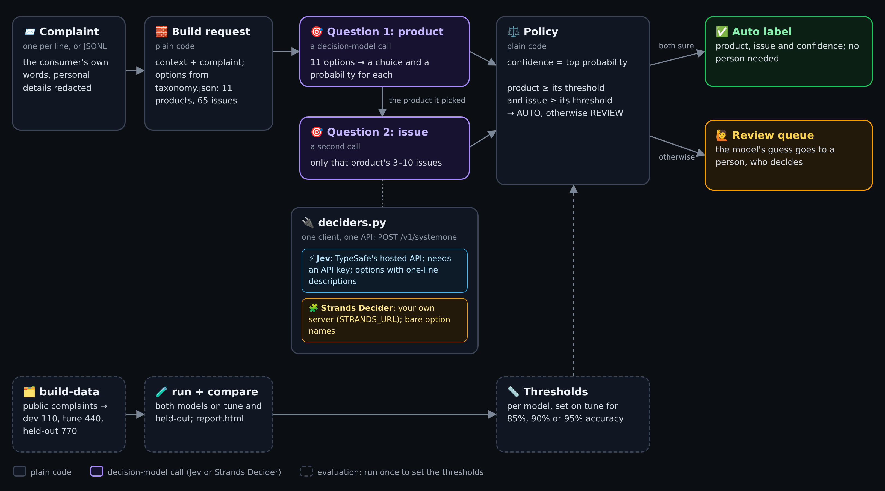
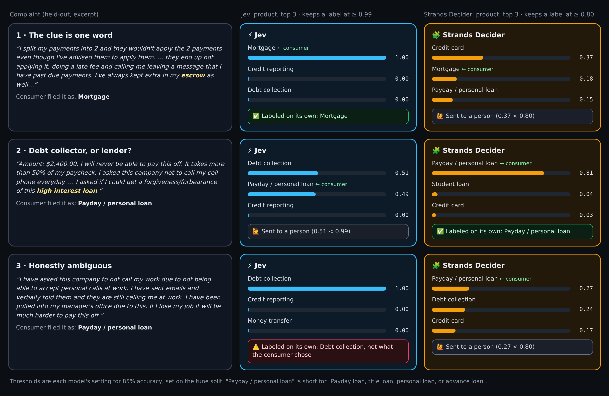

# Autolabel: label complaints with a decision model, and know when to ask a person

Autolabel sorts consumer complaints into a product (11 options) and an issue (3 to 10 options for that product)
with a decision model, and keeps a label only when the model is sure enough. The same code runs on two decision
models that serve the same `/v1/systemone` API:

- **[Jev](https://docs.typesafe.ai/concepts/system-one)**, TypeSafe's hosted model;
- **[Strands Decider 2B](https://github.com/strands-labs/strands-decider)**, an open-weights model you run yourself.

The repository is also a fair comparison of the two on 770 held-out real complaints, against two classic
TF-IDF classifiers.

## Run it

```shell
cd autolabel
uv run --group data autolabel build-data        # downloads ~1 GB once; rebuilds data/*.jsonl (already committed)

export TYPESAFE_API_KEY=...                      # Jev
uv run autolabel run tune --backend jev
uv run autolabel run heldout --backend jev

# Strands Decider: serve it, then point Autolabel at it
pip install strands-decider
strands-decider serve StrandsAgents/strands-decider-2B-qwen3.5-v1-2610 --port 8000
uv run autolabel run tune --backend strands     # STRANDS_URL defaults to http://127.0.0.1:8000/v1/systemone
uv run autolabel run heldout --backend strands

uv run autolabel compare                         # tables, results/compare/stats.json and report.html

echo "The collector keeps calling my work about a debt I already paid" | uv run autolabel label - --backend jev
```

| Command | What it's for |
| --- | --- |
| `build-data` | Builds the dev, tune and held-out splits (and 21,739 complaints to train the classifier baseline) from the public complaint database. `--parquet DIR` uses files you already have. |
| `run SPLIT --backend jev\|strands` | Asks both questions about every complaint in one request each. Appends to `results/<backend>/<split>.jsonl`, so an interrupted run resumes. |
| `compare` | Sets each method's thresholds on tune for 85%, 90% and 95% accuracy, applies them unchanged to held-out, and reports accuracy, calibration, the share each method labels on its own, speed and cost. Trains the classifiers on first run (a few minutes; cached in `results/baselines.json`). |
| `label FILE` | Labels your own complaints (one per line, or JSONL with `text`): product first, then the issue among that product's issues. Marks each `AUTO` or `REVIEW` using the thresholds `compare` set (`--target`), or `--min-confidence`. |

## How it works



Each complaint gets two decision-model calls: the product, then the issue among that product's issues. Plain code keeps the label when both confidences clear the model's thresholds and sends the rest to review. The thresholds come from `autolabel compare` on the labeled tune split. (For measurement, `run` asks both questions in one call and gives the issue question the true product.)

| File | Role |
| --- | --- |
| `autolabel/deciders.py` | One client for any `/v1/systemone` server. A backend is a URL, a model name, an optional API key and a price. Retries on 429, 5xx and dropped connections |
| `autolabel/questions.py` | The two questions and the 11 product descriptions. Issue options and their descriptions (the most common sub-issues) come from the database's own labels |
| `autolabel/data.py` | Builds the splits; the selection rules are in its docstring |
| `autolabel/metrics.py` | Accuracy, Brier score, calibration error, accuracy-coverage curves, threshold setting, bootstrap intervals |
| `autolabel/baselines.py` | TF-IDF + logistic regression, trained on 440 or 21,739 labels |
| `autolabel/compare.py`, `autolabel/report.py` | The comparison and its HTML report |

## Data

[US Consumer Complaint Database](https://www.consumerfinance.gov/data-research/consumer-complaints/) (CFPB, public
domain). Each complaint carries the product and issue **the consumer chose when filing**; nobody relabeled them, so
some labels are arguable (a credit report dispute filed under "Debt collection", say), and no method can reach 100%.

The CFPB's own downloads stopped including complaint text in 2026. `build-data` reads a
[July 2026 Parquet copy](https://huggingface.co/datasets/Mouwiya/cfpb-consumer-complaints) of the full database,
converted from the CFPB's CSV, that still has it.

| File | What it is |
| --- | --- |
| `data/dev.jsonl` | 110 complaints (10 per product): used to write the questions |
| `data/tune.jsonl` | 440 (40 per product): used to set each method's thresholds and to train the small classifier |
| `data/heldout.jsonl` | 770 (70 per product): the reported numbers; nothing was tuned on it |
| `data/taxonomy.json` | The 65 issues (at least 2% of their product's 2025 complaints) with their most common sub-issues |
| `data/train_large.jsonl` | 21,739 more complaints for the large classifier; not committed, `build-data` writes it |

Complaints were received in 2025, are 200 to 2,500 characters long, and their text appears only once in the
database (form letters filed thousands of times are dropped). Products are sampled equally: in the raw data three in
four complaints are about credit reports, which would make "always say credit reporting" look good.

## Protocol

- **Questions** were written on dev with both models in the loop, then frozen. Three wordings were tried; the
  instructions are the same for both models, but option descriptions helped Jev and hurt Strands Decider on dev, so
  each gets its better variant:

  | Dev, 110 complaints | Product: Jev / Strands | Issue: Jev / Strands |
  | --- | --- | --- |
  | Options with one-line descriptions | **81.8%** / 73.6% | **65.5%** / 53.6% |
  | "Which category did the consumer file it under?" | 81.8% / 75.5% | 62.7% / 52.7% |
  | Bare option names | 82.7% / **74.5%** | 60.0% / **64.5%** |

- **Thresholds** are set per method on tune (the lowest confidence whose kept complaints reach the target accuracy)
  and applied unchanged to held-out. For the 440-label classifier, tune answers are out-of-fold from 5-fold
  cross-validation.
- **The issue question is told the true product**, so it measures issue labeling on its own. `label` asks it with the
  predicted product instead.
- **Confidence** is the top option's probability.

## Results (jev-1.13.0, strands-decider-2B-qwen3.5-v1-2610, held-out, 770 complaints)

| Product (11 options) | Accuracy (95% interval) | Calibration error | Labels alone at 85% | at 90% | at 95% |
| --- | --- | --- | --- | --- | --- |
| **Jev** | **76.1%** (73–79%) | 0.184 | 70% of complaints, 86% accurate | none | none |
| **Strands Decider 2B** | 71.2% (68–74%) | **0.084** | 62%, 86% | **39%, 91%** | 31%, 93% |
| Classifier, 440 labels | 66.1% (63–69%) | 0.404 | 25%, 89% | 16%, 92% | 15%, 92% |
| Classifier, 21,739 labels | 77.7% (75–81%) | 0.075 | 82%, 86% | 68%, 90% | 37%, 97% |

| Issue (3 to 10 options) | Accuracy (95% interval) | Calibration error | Labels alone at 85% | at 90% | at 95% |
| --- | --- | --- | --- | --- | --- |
| **Jev** | 58.8% (56–62%) | 0.274 | none | none | none |
| **Strands Decider 2B** | 56.8% (53–60%) | **0.068** | 6%, 90% | 3%, 87% | 1%, 90% |
| Classifier, 440 labels | 49.0% (45–52%) | 0.087 | 7%, 93% | 7%, 94% | 6%, 93% |
| Classifier, 21,739 labels | 63.2% (60–67%) | 0.042 | 48%, 85% | 35%, 90% | 19%, 93% |

- **Jev is more accurate; Strands Decider's confidence is more trustworthy.** Jev's lead on product is 4.9 points
  (paired 95% interval 2.6 to 7.4); on issue, 2.1 points (−1.4 to 5.3), within noise.
- **Jev is overconfident on this data.** 639 of 770 product answers (83%) have a top probability of at least 0.99
  (Jev returns two decimals), and 82% of those are right. Since they all share one confidence, no threshold can pick
  a more accurate subset, so Jev never reaches 90% on tune or held-out. Strands Decider's largest bin (317 answers,
  95% average confidence) is 90% right.
- **Labels are noisy.** For 66 product labels (and 59 issue labels), Jev, Strands Decider and the 21,739-label
  classifier all agree on an answer other than the consumer's, for example a letter disputing hard inquiries on a credit
  report filed under "Debt or credit management".
- **Using both** (Jev's label, kept when Strands Decider agrees and is confident) labels 39% of products at 91%,
  the same as Strands Decider alone.
- **Hardest products** for both decision models: "Debt or credit management" (Jev 27%, Strands 11%), usually labeled
  debt collection or credit reporting, and "Prepaid card" (63%, 43%); Strands, given bare option names, often calls
  prepaid cards credit cards.
- **Speed and cost.** Jev: 53 ms median per complaint, 1,243 input tokens, $0.52 per 10,000 complaints. Strands
  Decider on a 16-core CPU (fp32, no GPU): about 3 s per complaint, alone or in a batch (three such servers labeled
  about 70 complaints a minute), 510 input tokens, no fee. The Strands team reports about 115 ms per question on a GPU.

## Three examples



Three held-out complaints where the two models disagree, at each model's 85%-accuracy threshold (Jev ≥ 0.99,
Strands Decider ≥ 0.80), product question only. The answers are in `results/*/heldout.jsonl` under these IDs.

| Complaint ID | Consumer's product | Jev | Strands Decider |
| --- | --- | --- | --- |
| 14674719 (mentions an escrow account) | Mortgage | Mortgage 1.00: kept, correct | Credit card 0.37: sent to a person |
| 13657214 (high-interest loan, half a paycheck) | Payday or personal loan | Debt collection 0.51: sent to a person | Payday or personal loan 0.81: kept, correct |
| 12427753 (calls at work about a debt) | Payday or personal loan | Debt collection 1.00: kept, disagrees with the consumer | Payday or personal loan 0.27: sent to a person |

Every model answer behind the results and examples above is in `results/jev/` and `results/strands/` (`tune.jsonl`, `heldout.jsonl`,
`dev.jsonl`, and the other dev wordings as `dev-<variant>.jsonl`). `autolabel compare` rebuilds the tables and
`results/compare/report.html` from them without calling either model (the large classifier needs
`data/train_large.jsonl`, which `build-data` writes).
