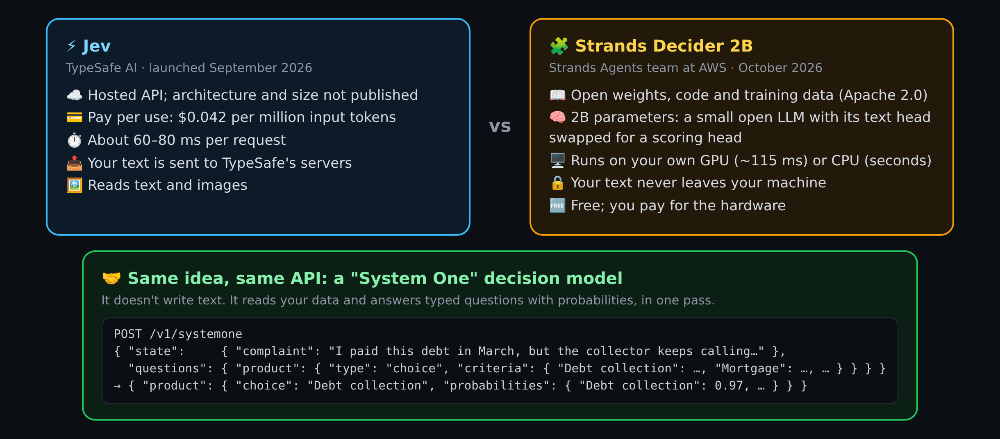
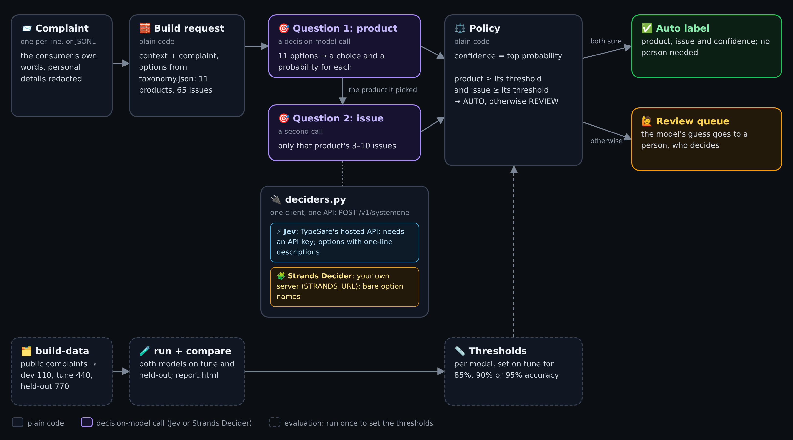
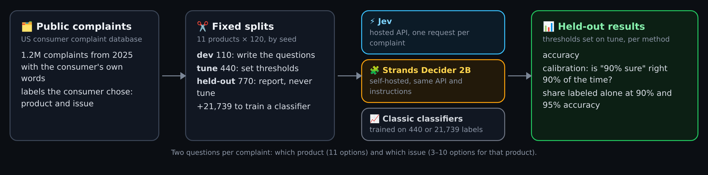
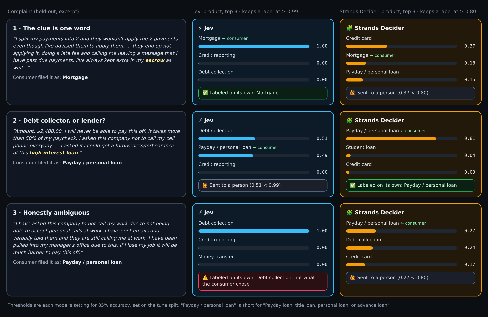
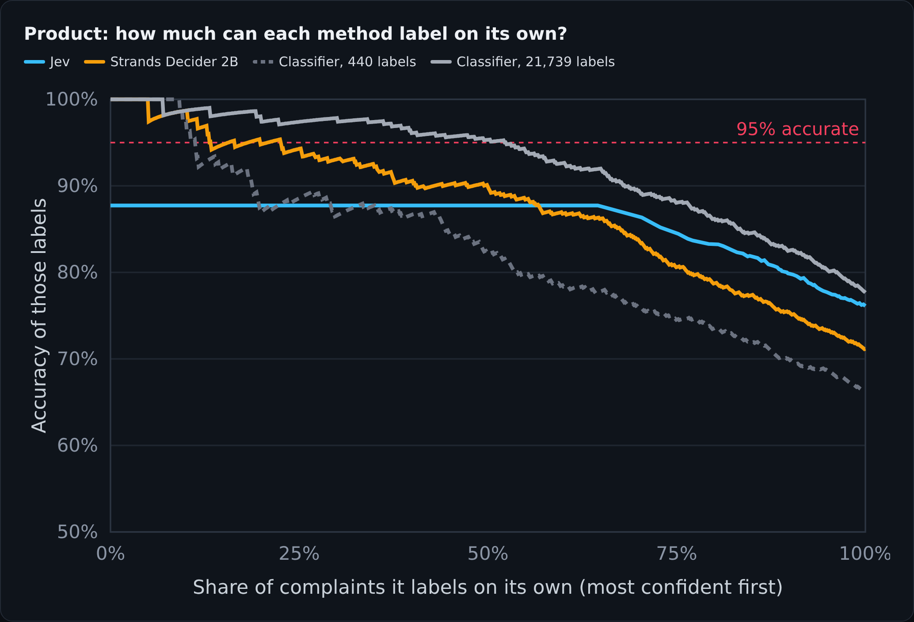
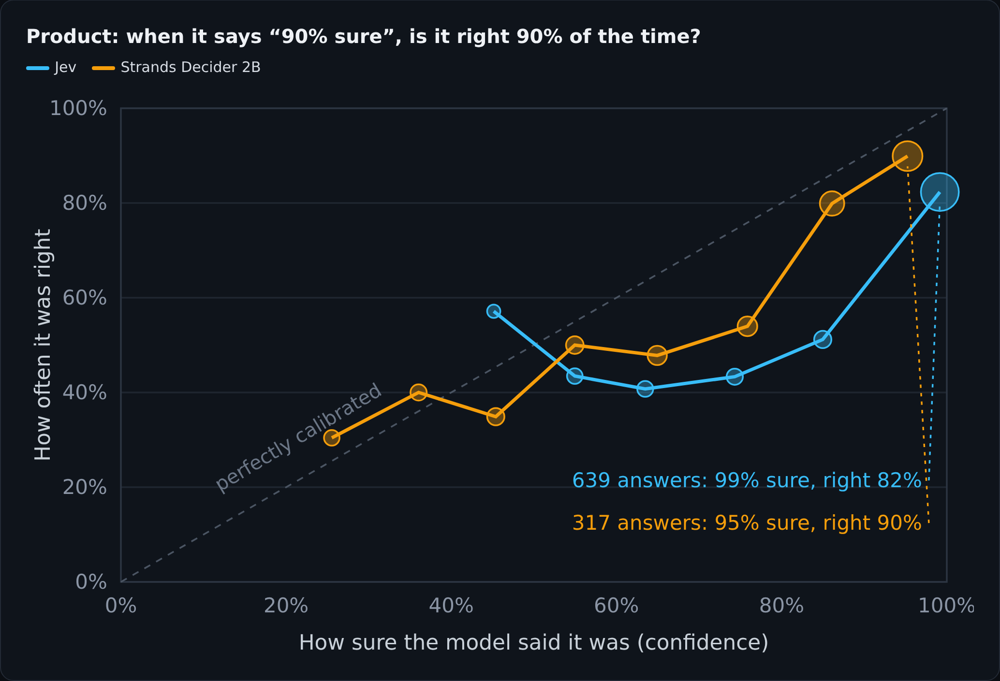

# How sure is "sure"? Jev vs Strands Decider on 770 real complaints

*Blog · AI · Data labeling · Jev · Strands · November 15, 2026 · 13 min read · [Source code on GitHub](https://github.com/mani-bellan/jev-apps/tree/main/autolabel)*

*"I paid this debt in March. The collector still calls me three times a day, and now it shows up on my credit report."*

Is that a complaint about debt collection, or about credit reporting? Is the problem the calls, or the report? Somebody has to decide, for every complaint, support ticket and survey answer. Teams that get thousands a week either pay people to sort them, or train a classifier, which first needs thousands of examples that people have already sorted.

Decision models offer a third way. You describe the categories in plain words, and the model picks one and tells you how sure it is. If it's sure, you keep its label. If not, a person looks. Two of these models came out two weeks apart this autumn: Jev, a paid hosted service, and Strands Decider, which is free and open. Both say they give you probabilities you can trust. I wanted to see which one I could actually leave alone with real data, judged the same way.

## TL;DR

| | |
|---|---|
| **What I built** | Autolabel: sorts consumer complaints into a product (11 options) and an issue (3 to 10 options per product) and keeps a label only when the model is sure enough. The same code runs on Jev or on Strands Decider by changing one URL. |
| **The data** | 1,320 real complaints that consumers sent to a US government agency in 2025, each with the product and issue the consumer picked when filing. Split before anything else into 110 to write the questions, 440 to set thresholds and 770 to report. |
| **Accuracy** | Product: **Jev 76%**, Strands 71%. A classic classifier needed 21,739 labeled complaints to reach 78%; trained on 440 it got 66%. Issue: Jev 59%, Strands 57%. |
| **Trust** | **Strands' confidence is honest; Jev's isn't.** Jev was 99% sure about 83% of complaints and right on 82% of those. When Strands said 95%, it was right 90% of the time. So Strands could label 39% of complaints on its own at 91% accuracy; Jev could never reach 90% at any threshold. |
| **Cost and speed** | Jev: about 50 ms and $0.52 per 10,000 complaints. Strands: free, but about 3 seconds per complaint on a 16-core CPU (a GPU would be far faster), and your data never leaves your machine. |

It's a small, exploratory comparison, and the labels themselves are noisy. The limits are at the end.

## Two decision models, one API

Most AI models write: answers, emails, code. A decision model doesn't write anything. You give it some text and a few typed questions, such as *yes or no*, *pick one of these options* or *rate this on a scale*, and it returns an answer to each with a probability, in a single pass. That makes it fast, cheap and easy to wire into code: no parsing, and every answer comes with a number you can set a threshold on.

**Jev**, from TypeSafe AI, started the category in September 2026. TypeSafe calls it a "System One" model, after the fast, intuitive half of thinking. It's a hosted API: you send a request and pay per token. Its size and architecture aren't published.

**Strands Decider 2B** arrived two weeks later from the Strands Agents team at AWS, as an open model anyone can download, inspect and run. It takes a small open language model (2 billion parameters), removes the part that writes text, and adds a small scoring head that rates each option you offer. Weights, code and training data are public under the Apache 2.0 licence.

The interesting part is that **both accept the same request.** Strands Decider deliberately serves the same API shape as Jev, so one program can call either by changing a URL. That is what made a fair comparison possible.

| | Jev | Strands Decider 2B |
|---|---|---|
| Made by | TypeSafe AI | Strands Agents team, AWS |
| How you use it | Hosted API | Download it and run it yourself |
| Openness | Closed; size and design not published | Open weights, code and data (Apache 2.0) |
| Cost | $0.042 per million input tokens | Free; you pay for the machine |
| Speed | About 50–100 ms per request | About 115 ms on a GPU (vendor figure); seconds on a CPU |
| Your data | Sent to TypeSafe's servers | Never leaves your machine |



*Two different products, one interface. The same request, a piece of text plus typed questions, gets the same kind of answer from both: a choice and a probability for every option.*

## The job: label complaints, and know when to ask

A US government agency publishes every complaint consumers send it about banks, lenders, debt collectors and credit bureaus, with personal details redacted. When filing, the consumer picks a **product** (credit card, mortgage, debt collection and 8 more) and an **issue** within it ("attempts to collect debt not owed", "problem with a purchase shown on your statement"). In 2025 alone, 1.2 million complaints came with the consumer's own words.

That makes a good labeling test: real writing, real categories, and labels that came from somebody other than me. I asked each model two questions about every complaint:

- **Which product is this about?** One of 11, each with a one-line description.
- **What is the main problem?** One of the 3 to 10 issues for that product.

But accuracy alone isn't the point. In a real labeling pipeline you let the model label what it's sure about and send the rest to a person. So the question that matters is: **how many complaints can it label on its own while staying, say, 90% accurate?** That only works if "90% sure" really means right 90% of the time. Both models say their probabilities are calibrated in exactly that sense. This project tests it.

Autolabel is built around that idea. Each complaint gets two questions: first the product, then the issue, offering only the issues of the product the model picked. A few lines of plain code then compare each answer's confidence with a threshold: if both clear it, the label is kept; if not, the complaint goes to a person with the model's guess attached. The thresholds aren't guesses either: they're set once per model, on complaints whose labels I already have, for the accuracy I want. The same client talks to Jev or to a Strands Decider server; switching is one setting.



*How Autolabel works. Purple boxes are calls to a decision model, Jev or Strands Decider through the same client; grey boxes are plain code. The dashed row runs once, on labeled complaints, to set each model's thresholds.*

## A fair fight

Comparing a model you call over the internet with one you run yourself is easy to get wrong, so I fixed the rules first.

- **Fixed splits, decided before any model saw them.** 120 complaints per product, picked by a seed: 110 to write the questions (dev), 440 to set thresholds (tune) and 770 to report (held-out). Nothing was tuned on the held-out set. Products are sampled equally on purpose: in the raw data three in four complaints are about credit reports, which would make "always say credit reports" look clever.
- **Real labels, untouched.** Every label is the one the consumer chose. Nobody relabeled anything, including me.
- **Same instructions, each model's best wording.** I wrote the questions on the dev set with both models in the loop and tried three wordings. One mattered: describing each option in a line helped Jev on the issue question (66% vs 60% on dev) but hurt Strands (54% vs 65%). So Jev gets the descriptions and Strands gets bare option names, the best of what I tried for each.
- **Thresholds set per model.** Each model's confidence lives on its own scale, so each gets its own threshold, set on the tune set for a target accuracy (85%, 90% or 95%), then applied unchanged to held-out.
- **Issues scored on their own.** For the numbers below, the issue question is told the true product, so a wrong product doesn't also count as a wrong issue. (The app itself asks with the product it picked.)
- **Two classic baselines.** A TF-IDF classifier (word counts plus logistic regression) trained on the same 440 tune complaints, and one trained on 21,739 more. The first shows what you get with a few hundred labels; the second shows what you get when you've already paid for a lot of them.



*How the numbers were produced. Every method answers the same two questions about the same complaints; thresholds come from the tune set only.*

## Three complaints, two models

Before the averages, here is what a run actually looks like. The three complaints below are from the held-out set. The bars show the probabilities each model gave its top three products, and the box underneath shows what Autolabel did with that answer, using each model's threshold for 85% accuracy: Jev's label is kept at 0.99 or more, Strands' at 0.80 or more. (85% is the strictest target at which both models can label anything on their own.)



*Three real complaints, as each model saw them. Excerpts are lightly trimmed; the issue answers are left out to keep it readable.*

**1. The clue is one word.** Nothing in this complaint says "mortgage", except "escrow", the account a mortgage lender keeps for property taxes and insurance. Jev caught it and was certain, and Autolabel kept its label, correctly. Strands missed the clue and guessed credit card, but only at 0.37, so the complaint went to a person. Strands was wrong, but it didn't cost a wrong label, only a minute of someone's time.

**2. Debt collector, or lender?** A $2,400 high-interest loan eating half a paycheck, with daily calls. Jev split almost evenly between debt collection and a payday or personal loan, so its answer went to a person. Strands said payday or personal loan at 0.81, just over its bar, and was right.

**3. Honestly ambiguous.** Someone keeps calling this consumer at work about money they owe. A collector, or the lender itself? The text doesn't say; the consumer filed it under payday loans. Strands spread its bet across three products and sent it to a person, which is the right call for a complaint like this. Jev answered debt collection at 1.00, so Autolabel kept a label the consumer would disagree with, without anyone looking. That happened often enough to matter: 74 of Jev's 184 wrong product answers came at 0.99 or higher.

## Results

On the 770 held-out complaints:

| Product (11 options) | Accuracy | Labels on its own, aiming at 85% | Aiming at 90% | Aiming at 95% |
|---|---|---|---|---|
| **Jev** | **76%** | 70% of complaints, 86% accurate | none: never reaches 90% | none |
| **Strands Decider 2B** | 71% | 62%, 86% accurate | **39%, 91% accurate** | 31%, 93% accurate |
| Classifier, 440 labels | 66% | 25%, 89% accurate | 16%, 92% accurate | 15%, 92% accurate |
| Classifier, 21,739 labels | 78% | 82%, 86% accurate | 68%, 90% accurate | 37%, 97% accurate |

Three things stand out.

**Jev is the more accurate labeler.** Five points ahead of Strands on product, a clear gap; two on issue, which is within the noise. And it got there with no training examples at all, nearly matching a classifier that needed 21,739 labeled complaints.

**Strands knows when it doesn't know.** Below 90%, the two are close: both can label 62% to 70% of complaints at 86% accuracy. Above it, they part ways. Strands can label 39% of complaints at 91% accuracy, or 31% at 93%. Jev can't reach 90% at any threshold.

The chart shows why. Sort each method's answers from most to least confident and keep the top slice: how accurate is that slice?



*Further right at the same height is better. Jev's line is flat for its first 65% because it gives all of those complaints the same confidence, 1.00, so there is no way to pick its best answers out of them.*

**Issues are hard for everyone.** Picking the issue is a much finer distinction, and the consumers' own choices are inconsistent. All four methods top out at 49% to 63%, and only the large classifier can label a meaningful share on its own (48% at 85% accuracy). For issues, a decision model is a suggestion box for a person, not a replacement.

## Can you trust its confidence?

This is the heart of it. A model is calibrated when its confidence matches reality: of everything it says it's 90% sure about, 90% is right.



*Each dot groups answers by confidence; bigger dots hold more answers. On the dashed diagonal, "90% sure" means right 90% of the time.*

Jev put 83% of all product answers at 99% confidence or more, and those were right 82% of the time. That's overconfidence: a "99%" that behaves like an "82%". Strands' biggest group sat at 95% confidence and was right 90% of the time, close to the line. Its average calibration error was 0.08, against Jev's 0.18. On issues the gap is wider: 0.07 against 0.27.

In practice, this decides what a threshold can do for you. With Strands, raising the bar buys you accuracy. With Jev, beyond a point, it buys you nothing: two thirds of its answers say the same thing.

Part of what looks like Jev's overconfidence is the labels themselves. For 66 of the 770 complaints, Jev, Strands and the classifier trained on 21,739 consumer labels all agreed on a product, and it wasn't the one the consumer picked. One is a letter disputing hard inquiries on a credit report, filed under "debt or credit management"; another, a problem with a payment app, filed under "credit card". When the "right answer" is wrong, a model that's correct and sure gets marked confidently wrong. But Strands faced exactly the same labels and stayed calibrated, so noise doesn't explain the whole gap.

## Speed, cost and privacy

| | Jev | Strands Decider 2B (on CPU) |
|---|---|---|
| Time per complaint | 53 ms (median) | about 3 s alone on a 16-core server, and about the same per complaint in a batch |
| Cost per 10,000 complaints | $0.52 | no fee; about 7 hours of one 16-core server |
| Input per complaint | 1,243 tokens (with option descriptions) | 510 tokens (bare option names) |
| Where your text goes | TypeSafe's servers | nowhere |

Jev is effectively free and instant at this scale. Strands has no fee, but on a CPU it's slow. I ran three 16-core cloud servers side by side and they worked through about 70 complaints a minute. The Strands team reports about 115 ms per question on a gaming GPU, which would change that picture completely; I didn't have one to test.

The case for Strands isn't speed. It's that you can run it where your data lives, inspect how it was trained, and pay nothing per call. For complaints, medical notes or anything you can't send to a third party, that may matter more than five points of accuracy.

## What I learned

1. **Accuracy and honesty are different properties.** The more accurate model was the less trustworthy one about its own answers. If you plan to auto-accept labels above a threshold, test calibration, not just accuracy.
2. **A decision model with zero examples can match a classifier trained on twenty thousand.** Jev labeled products within two points of a classifier that needed 21,739 labeled complaints. Strands beat the one trained on 440. If you don't have labeled data yet, start here.
3. **Prompts don't transfer between models.** The same option descriptions that helped Jev cost Strands 11 points on issues in my dev tests. Same API doesn't mean same behavior: tune the wording for each model on data you won't report on.
4. **Your "ground truth" is somebody's guess.** About 1 in 12 complaints carries a product label that all three strong methods disagree with. Every number here is agreement with what consumers picked, so a perfect score isn't possible.
5. **Two models are not automatically better than one.** Accepting Jev's label only when Strands agreed and was confident labeled 39% at 91%, the same as Strands alone.
6. **Hardware is the real price of open.** "Free" Strands took about 3 seconds per complaint on a CPU. Budget for a GPU if you need volume.

## Limits

- **Noisy labels.** Consumers choose their own categories, and some choices are odd. All accuracy numbers are agreement with those choices.
- **One domain, one language.** US financial complaints in English, 200 to 2,500 characters long, products sampled equally. Results on support tickets or other languages may differ.
- **One version of each model.** Jev `jev-1.13.0` and `strands-decider-2B-qwen3.5-v1-2610`, in November 2026. Strands also comes in larger sizes (up to 26B), which its team reports as more accurate; I only tested the 2B.
- **Small held-out set.** 770 complaints, 70 per product, so each accuracy figure has a margin of about ±3 points. Jev's 5-point lead on product holds up (95% interval: 2.6 to 7.4 points); its 2-point lead on issues doesn't (−1.4 to 5.3).
- **Jev returns probabilities rounded to two decimals**, so I couldn't rank answers inside its 1.00 block. Finer probabilities might let a threshold separate them.
- **Different option descriptions.** Each model got its best wording from the dev set, so the two didn't see identical prompts.
- **Strands on CPU only.** The speed figures for Strands are for 16-core CPU servers, not a GPU.

## Try it

```bash
git clone https://github.com/mani-bellan/jev-apps && cd jev-apps/autolabel

export TYPESAFE_API_KEY=...                   # Jev: https://console.typesafe.ai/keys
uv run autolabel run heldout --backend jev

pip install strands-decider                   # Strands Decider, on your own machine
strands-decider serve StrandsAgents/strands-decider-2B-qwen3.5-v1-2610 --port 8000
uv run autolabel run heldout --backend strands

uv run autolabel compare                      # tables, calibration charts and an HTML report
echo "The collector keeps calling my work about a debt I already paid" | uv run autolabel label - --backend jev
```

The repository includes the 1,320 complaints with their labels, the script that rebuilds them from the public database, both classifier baselines, and every model answer behind the numbers above.
