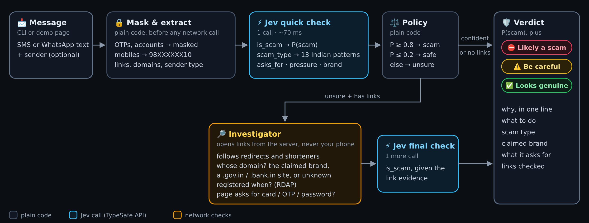

# Scam Shield: flag scam SMS and WhatsApp messages with Jev

Forward a suspicious message and get a verdict (scam, unsure or safe), the kind of scam, and one line on why and
what to do, in about 100 ms. One [Jev](https://docs.typesafe.ai/concepts/system-one) call answers five questions
about the message; a few lines of plain Python turn those answers into the verdict. When that quick check is unsure
and the message has links, an investigator opens each link, checks who owns the domain and when it was registered,
reads the landing page, and asks Jev again with that evidence.

The number that matters most is **false alarms on genuine messages**: a shield that flags your bank's OTP gets
uninstalled.

## Run it

```shell
cd scam-shield
export TYPESAFE_API_KEY=...

uv run shield check "Your electricity will be disconnected tonight. Call officer 9876543210"
uv run shield check --sender VM-HDFCBK-S --explain "482913 is your OTP for HDFC login. Do not share."
pbpaste | uv run shield check -                      # read from stdin (pbpaste is the Mac clipboard)

uv run shield check --investigate "Update your address: did.li/Ca3TY"   # check links even when confident

uv run shield eval data/public_india_tune.jsonl      # accuracy, baselines and an HTML report
uv run shield eval mendeley --sample 600             # public sets download on first use
uv run shield label raw/messages.txt --out data/india.jsonl
uv run shield serve --port 8000                       # demo web page
```

| Command | What it's for |
| --- | --- |
| `check` | Verdict for one message, plus the link evidence when it was investigated. `--explain` shows what Jev saw (after masking) and every answer with probabilities; `--json` prints everything; `--investigate` checks links even when the quick check is confident; `--no-investigate` skips the investigator. |
| `eval` | Runs a labeled set through Jev (reported as `jev`, and `jev-quick` for the quick check alone) and two baselines (keyword rules, and a TF-IDF classifier scored with 5-fold cross-validation). Prints catch rate, false alarms and unsure share per language, and writes `results/<timestamp>/` with `predictions.jsonl`, `stats.json` and `report.html` listing every miss and false alarm next to Jev's answers. |
| `serve` | A one-page demo: paste a message (or pick an example), see the verdict, why, what to do, the link evidence, and the masked text Jev saw. Standard library only. |
| `label` | Builds a labeled set from raw messages (separated by blank lines, optional first line `From: <sender>`). Masks private numbers before saving, suggests a label from Jev (`--no-suggest` to label blind), and resumes where you stopped. |

A labeled record is one JSON line: `{"text", "label": "scam" | "legit" | "spam", "sender"?, "scam_type"?, "lang"?}`.
`spam` means unwanted but not fraudulent (promotions) and counts toward neither catch rate nor false alarms.
`lang` (`en`, `hinglish`, `hi`) is guessed when missing.

## How it works



Write-up: [A second opinion on scam texts in under a second](../blog/scam-shield.md).

| File | Role |
| --- | --- |
| `shield/extract.py` | Masks OTPs, account, card, Aadhaar and mobile numbers (keeping their shape, so "asks you to call a mobile number" survives); pulls out link domains; describes the sender (registered business sender ID, with its promotional/service/transactional/government suffix, or a personal number) |
| `shield/jev.py` | One call, five questions: `is_scam` (yes/no), `scam_type` (13 Indian scam patterns, 3 genuine types, `unclear`), `asks_for`, `pressure` (score), `brand`. Pinned to `jev-1.13.0` because thresholds depend on one version's probabilities |
| `shield/policy.py` | P(scam) ≥ 0.8 → scam, ≤ 0.2 → safe, otherwise unsure; explanation templates per scam type |
| `shield/investigate.py` | For unsure messages with links: follows redirects, classifies the landing domain (official domain of the claimed brand, a `.gov.in`/`.nic.in`/`.bank.in` domain, an official domain of a *different* company, a link shortener or open platform, or unknown), looks up its registration date over RDAP, reads the page title, text and form fields (password, card, OTP…), notes APK downloads without downloading them, then asks Jev a final `is_scam` with that evidence |
| `shield/pipeline.py` | Quick check, then the investigator when the quick check is unsure (or `--investigate`) |
| `shield/baselines.py` | Keyword rules and TF-IDF + logistic regression |
| `shield/evaluate.py`, `shield/report.py` | Metrics by language and the HTML report |

Masked text is what Jev sees and what `label` saves; raw OTPs and account numbers never leave your machine.

## Data

| Set | What it is | Use |
| --- | --- | --- |
| `data/smoke.jsonl` | 47 messages written for this repo modeled on Indian formats: 24 scams, 19 genuine alerts and chats, 4 promotions, in English, Hinglish and Hindi | Smoke test only. It was written by the same person who wrote the questions, so its numbers flatter Jev |
| `mendeley` | [SMS Phishing Dataset](https://data.mendeley.com/datasets/f45bkkt8pr/1), Mishra & Soni 2022, CC BY 4.0: 5,971 messages, mostly older UK and global SMS | Sanity check, not an India test |
| `hinglish-hf` | The hand-written Hinglish rows (35 detected) of [bolewara/hinglish-scam-text-dataset](https://huggingface.co/datasets/bolewara/hinglish-scam-text-dataset), CC BY 4.0 | Small Hinglish sanity check |
| `data/public_india_tune.jsonl` | **53 real messages received in India** (41 scams, 11 genuine, 1 promotion), collected from public sources | Look at these, tune on these |
| `data/public_india_heldout.jsonl` | **36 more** (27 scams, 8 genuine, 1 promotion) | The honest number: run it, don't tune on it |
| `data/public_india_extra.jsonl` | 47 more public messages that are *not* clean received SMS/WhatsApp texts: examples written by banks and payment apps (25), Facebook or Instagram posts and notice images (14), translations by the publisher (5), and texts that are distorted or only make sense in context (3) | Secondary; don't mix into headline numbers |

### How the public India sets were collected

Every record is a message whose full text was printed on a public page, or shown in a screenshot that was
transcribed, with `source_url`, `published` date, `capture` (`page-text` or `image-transcribed`) and `notes`.
Sources: PIB Fact Check and Vishvas News fact-checks, I4C and police advisories, bank and payment-app fraud-awareness
pages, news reports quoting messages people received (Times of India, India Today, Economic Times, Business
Standard, Dainik Jagran and others), and r/IsThisAScamIndia and other Indian subreddits, which also supplied most
of the genuine messages: real messages people suspected but that turned out to be genuine (a FedEx customs KYC
request, Microsoft's aka.ms security alert, an Income Tax refund notice, agent-visit KYC messages for a credit card).
Paraphrased or partial quotes were skipped, near-duplicates removed, and numbers masked with the same `redact` the
app uses. A spot check of 5 random page-text records found all 5 verbatim on their source pages; image
transcriptions were not re-checked.

The 89 received messages were split 60/40 into `public_india_tune` and `public_india_heldout`, stratified by label
and scam type (seed 7), before any tuning.

Known biases: public scams are the newsworthy ones, so they are cleaner and more typical than a real inbox; genuine
messages are few (19), so one false alarm moves the rate by 5 points; Hindi and Hinglish are thin.

## Results (jev-1.13.0)

With the investigator (`jev`) and without it (`jev-quick`):

| Set | Catch rate | Missed | False alarms | Unsure | Quick check alone: catch / unsure | TF-IDF catch / false alarms | Rules catch / false alarms |
| --- | --- | --- | --- | --- | --- | --- | --- |
| **public_india_heldout, 36** | **0.93** | 0.04 (1 of 27) | **0 of 8** | 11% | 0.93 / 11% | 1.00 / 1.00 | 0.48 / 0.00 |
| public_india_tune, 53 | 0.90 | 0.02 (1 of 41) | 0 of 11 | 13% | 0.85 / 19% | 1.00 / 0.73 | 0.49 / 0.27 |
| public_india_extra, 47 | 0.84 | 0.02 | 1 of 3 | 15% | 0.84 / 15% | – | 0.36 / 0.33 |
| smoke, 47 | 1.00 | 0.00 | 0 of 19 | 2% | 1.00 / 2% | 0.75 / 0.37 | 0.42 / 0.00 |
| mendeley, 600 sampled (quick check only) | 0.78 | 0.00 | 0 of 487 | 10% | – | 0.81 / 0.00 | 0.09 / 0.00 |
| hinglish-hf, 35 (quick check only) | 1.00 | 0.00 | 0 of 21 | 0% | – | 1.00 / 0.00 | 0.36 / 0.00 |

- **No genuine message in the public India sets was called a scam.** Nothing was tuned on the held-out set; the
  thresholds are unchanged from the first version.
- **What the investigator did.** On the tune set it opened links for 3 messages: two parcel scams on link
  shorteners went from unsure to scam (P 0.74→0.85, 0.76→0.87), and Microsoft's genuine `aka.ms` alert, which
  redirects to `account.microsoft.com`, went from unsure to safe (0.60→0.11). On the held-out set it opened links
  for 2 genuine messages and moved both the right way without crossing the safe line: FedEx KYC on `kyc.fedex.com`
  (0.55→0.23) and an emergency SOS with a Google Maps link (0.63→0.46).
- **Most remaining unsure messages have no link to check:** they ask you to call a mobile number (gas disconnection,
  "friendship club") or quote no link (the published copy dropped it). Phone numbers have no free reputation source.
- **Thresholds stay at 0.8 / 0.2.** Lowering the scam line to 0.6 would catch three more tune-set scams, but the
  genuine Hindi PNB alert in the smoke set scores 0.74 and would become a false alarm.
- **The two misses are fair misses for a text-only check:** a Hindi WhatsApp message whose danger was the attached
  wedding-card APK, and a Hinglish task-scam follow-up that only reads as a scam in the context of the chat.
- **TF-IDF catches everything but flags most genuine messages**: with this little data it learns "looks like an
  alert" rather than "is fraud".
- **Scam type.** "Free recharge" forwards (the PM, Ambani or TRAI supposedly giving free recharges, cash or laptops)
  were labeled `prize_lottery` and called `other_scam` by Jev, so they got their own `free_scheme` type: the 15 such
  records were relabeled by that rule, and the type was written against the tune set. Scam-type accuracy went from
  0.83 to 0.90 on the tune set and from 0.81 to **0.93 on the held-out set**; verdicts didn't change.
- The one false alarm in the extra set is a genuine HDFC Re-KYC message as reprinted in a news article with a garbled
  sender ID and link (P(scam) 0.90).

Cost: the quick check is about 1,800 input tokens (roughly $7.50 of Jev per 100,000 messages, 60–80 ms median); an
investigated message adds a second call of about 700–1,000 tokens plus 1–8 seconds of link checks.

Caveats for the investigator numbers: it ran in October 2026 on messages from 2019–2026, so most scam links no longer
resolve. Domain age is measured against the message's published date, and an unreachable link is described to Jev
as weak evidence, but a live deployment would see more working scam pages than this evaluation did. Google Safe
Browsing is not used (it needs an API key and is non-commercial only).

## Next

- **Agent investigator (M3):** let an LLM agent choose which checks to run, including web searches for known scam
  wordings and the claimed company's real contact details, and measure whether it beats the fixed order. Blocked on a
  search API key (no keyless web search works from a server) and on OpenRouter's free-tier limit of about 50
  requests a day. When evaluating on public messages, exclude each message's own source page from search results.
